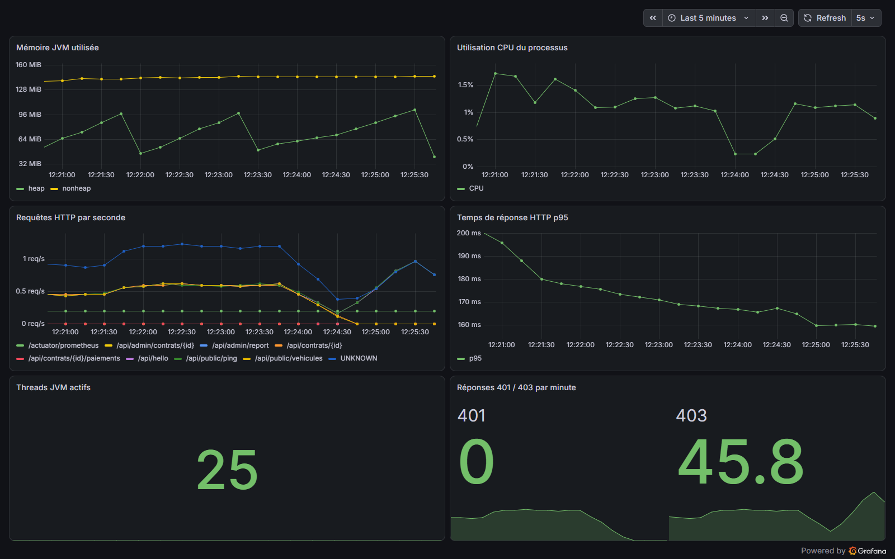

# AutoLoc API — Spring Boot, JPA, Spring Security, Prometheus et Grafana

API REST de location de véhicules réalisée pour les workshops **UP ASI — Architecture des systèmes d'information** (ECE, 2026-2027). Elle prolonge le projet **RentCar** (TP2 Conception SI) : même domaine métier, cette fois avec Spring Boot et JPA.



## Contenu

| Workshop | Livré |
|---|---|
| 1, session 1 : projet Spring Boot et première entité | `pom.xml` (Web, Data JPA, MySQL, Lombok, Validation, DevTools), `application.properties`, entité `Vehicule` |
| 1, travail personnel : entités restantes | `Agence`, `Client`, `Employe`, `Equipement`, `Reservation`, `Contrat`, `Paiement`, `Maintenance` et les énumérations `StatutVehicule`, `CategorieVehicule`, `RoleEmploye`, `StatutReservation`, `ModePaiement` |
| 1 étendu : associations, cascade, fetch | les 8 associations du modèle, toutes en `LAZY` ; `Contrat ↔ Paiement` bidirectionnelle avec `mappedBy`, `ALL` et `orphanRemoval` ; justification dans [`docs/fetch-strategy.md`](docs/fetch-strategy.md) |
| Défi Spring Security | `SecurityConfig` (HTTP Basic, BCrypt, rôles USER et ADMIN), `SecurityDemoController` ; notes dans [`docs/security-notes.md`](docs/security-notes.md) |
| Lab monitoring | Actuator, Micrometer, `monitoring/prometheus.yml`, `docker-compose.yml`, tableau Grafana à 6 panneaux chargé automatiquement ; notes dans [`docs/monitoring-notes.md`](docs/monitoring-notes.md) |
| Pour aller plus loin | `CommandLineRunner` de démonstration (`DonneesDemo`, profil `dev`), `application-dev.properties` |

## Architecture

```
fr.ece.autoloc
├── domain           entités JPA et énumérations
├── repository       interfaces Spring Data JPA
├── service          logique métier transactionnelle (VehiculeService, ContratService)
├── web.controller   contrôleurs REST
├── web.dto          DTO (records) exposés par l'API
└── config           SecurityConfig, DonneesDemo
```

Modèle (multiplicités UML) : Agence 1—* Vehicule ; Agence 1—* Employe ; Vehicule *—* Equipement ; Client 1—* Reservation ; Reservation *—1 Vehicule ; Reservation 1—0..1 Contrat ; Contrat 1—* Paiement (composition) ; Vehicule 1—* Maintenance.

## Technologies

Java 17+ (testé avec le JDK 25 d'IntelliJ), Spring Boot 4.1, Spring Data JPA / Hibernate, MySQL 8 (WampServer), Lombok, Spring Security, Actuator, Micrometer, Prometheus, Grafana, Docker Compose.

## Installation et lancement

1. Démarrer MySQL (WampServer). La base `autoloc_db` est créée automatiquement (`createDatabaseIfNotExist=true`).
2. Le mot de passe MySQL n'est pas écrit dans le dépôt. Il se lit dans les variables d'environnement `DB_HOST`, `DB_PORT`, `DB_USERNAME` et `DB_PASSWORD` (par défaut `localhost`, `3306`, `root` et un mot de passe vide, comme sous WampServer).
3. Lancer `AutolocApiApplication` dans IntelliJ (activer *Annotation processing* pour Lombok), ou en ligne de commande :

```bash
mvn spring-boot:run
```

Au démarrage, Hibernate crée les tables (`ddl-auto=update`) et le profil `dev` insère un jeu de démonstration si la base est vide.

4. Pour la supervision (Docker Desktop doit être démarré) :

```bash
docker compose up -d
```

Prometheus répond sur http://localhost:9090 et Grafana sur http://localhost:3000.

## Points d'accès

| Méthode et URL | Accès | Rôle |
|---|---|---|
| `GET /api/public/ping` | public | test de disponibilité |
| `GET /api/public/vehicules` | public | véhicules disponibles (DTO) |
| `GET /api/hello` | USER, ADMIN | test d'authentification |
| `GET /api/vehicules` | USER, ADMIN | parc complet |
| `GET /api/contrats/{id}` | USER, ADMIN | contrat et paiements (`join fetch`) |
| `POST /api/contrats/{id}/paiements` | USER, ADMIN | ajoute un paiement, enregistré par cascade (`{"montant":97,"modePaiement":"CARTE"}`) |
| `GET /api/admin/report` | ADMIN | rapport confidentiel |
| `DELETE /api/admin/contrats/{id}` | ADMIN | supprime un contrat et ses paiements (composition) |
| `GET /actuator/health`, `/actuator/prometheus` | public | supervision |

Comptes de TP (en mémoire, **pas de vrais identifiants**) : `student` / `student123` (USER) et `admin` / `admin123` (ADMIN).

## Vérifications effectuées

- Démarrage : les 10 tables sont créées, dont la table de jointure `vehicule_equipement`, ainsi que les clés étrangères `id_agence`, `id_client`, `id_vehicule`, `id_reservation` (unique) et `id_contrat`.
- Sécurité : la matrice 200 / 401 / 403 correspond à l'énoncé (`docs/captures/01_securite_200_401_403.png`).
- Cascade : `POST …/paiements` insère le paiement sans `PaiementRepository`. `DELETE /api/admin/contrats/1` supprime le contrat et ses 2 paiements, la réservation reste.
- Validation : un montant négatif est refusé (400).
- Monitoring : la cible `autoloc-api` est UP dans Prometheus et les 6 panneaux Grafana sont alimentés.

## Auteurs

Groupe ECE : NGONGANG NOUDJI Fournier · WABO MBA Miguel Jovan · MPACKO DISSAKE Allegra Anaelle · BOYEKON BAFALAK Alane Bryan.
