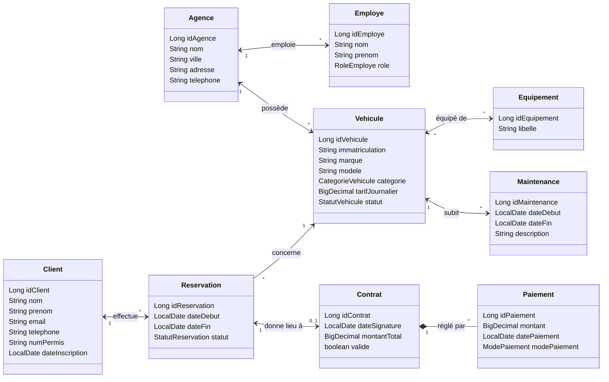

# Modèle conceptuel AutoLoc (diagramme de classes)

Ce diagramme correspond exactement aux entités JPA du paquet `fr.ece.autoloc.domain`. Les flèches indiquent la navigabilité (côté qui connaît l'autre), et le losange plein la composition Contrat ◆— Paiement.

| Énumération | Valeurs |
|---|---|
| `StatutVehicule` | DISPONIBLE, LOUE, MAINTENANCE |
| `CategorieVehicule` | CITADINE, BERLINE, SUV, UTILITAIRE |
| `RoleEmploye` | AGENT, MANAGER |
| `StatutReservation` | EN_ATTENTE, CONFIRMEE, ANNULEE, TERMINEE |
| `ModePaiement` | CARTE, ESPECES, VIREMENT |

## Correspondance avec RentCar (TP2)

| RentCar (TP2, conception UML) | AutoLoc (workshops Spring Boot) |
|---|---|
| Vehicule, Categorie, Tarif | Vehicule (`categorie` en énumération, `tarifJournalier`) |
| Client | Client |
| Employe | Employe (+ rôle AGENT / MANAGER) |
| Reservation | Reservation |
| Location (contrat) et Paiement | Contrat 1 — * Paiement (composition) |
| (absent) | Agence, Equipement, Maintenance |
